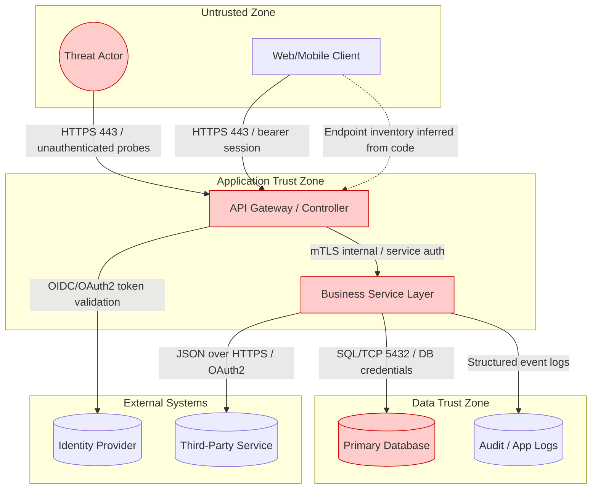
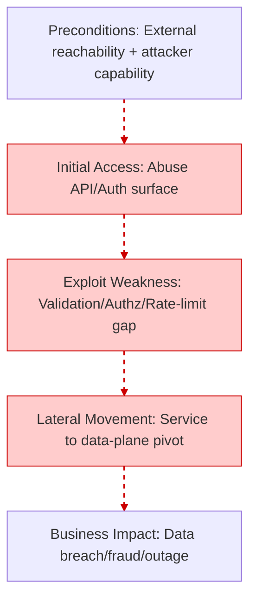

# Automated Threat Modeling and Security Scan Report

## Repository Identity

**GitHub Owner / Username:** yantongggg
**Repository:** FYP
**Full Repository Name:** yantongggg/FYP

**Organization:** mbbgrp
**Report Date:** 2026-03-03
**Report Version:** tm-scan v1.0.0
**Report ID:** 20260303_030800
**Report Classification:** Confidential

## Scan Metadata

- **Scan Mode:** quick
- **Since Days:** 30
- **Git Depth:** 1
- **Keyword Hits:** 570
- **Rule Hits:** 12
- **SAST Hits (line-level):** 9
- **OpenAPI Specs Found:** 0
- **DB Migration Files:** 8
- **Secret Findings (gitleaks):** 0
- **Total Packages (SBOM):** 0

## SYSTEM CONTEXT

### Actors
- Authenticated User
- External Attacker
- Identity Provider / Session Authority
- Unauthenticated Internet User

### Assets
- User/PII Data (High sensitivity) - 104 evidence indicator(s)
- Credentials/Secrets (High sensitivity) - 25 evidence indicator(s)
- Datastores (postgres, postgresql, users) (High sensitivity)

### Entry points
- Authentication-related endpoints/signals: authenticate, jwt, login, oauth, oidc, password, session

### Trust boundaries & Assumptions
- Internet -> Application boundary is untrusted by default.
- Application -> Data store boundary is privileged and must enforce least privilege.
- Application -> External services boundary assumes network egress controls and TLS.
- All client-supplied business fields are treated as untrusted until server validation.

## ARCHITECTURE MODEL

## DATA FLOW MATRIX

| Source | Destination | Data type | Protocol | Authentication | Crosses trust boundary (Y/N) |
|--------|-------------|-----------|----------|----------------|-------------------------------|
| API Gateway / Controller | Business Service Layer | Validated Domain Request | Internal RPC/HTTP | Service Identity | N |
| API Gateway / Controller | Identity Provider | Token Introspection / Claims | HTTPS | OAuth2/OIDC | Y |
| Application Config | Business Service Layer | Connection Strings / Secrets | Env/File | Runtime Process Access | N |
| Business Service Layer | Audit / App Logs | Security Events | Structured Logging | N/A | N |
| Business Service Layer | Primary Database | PII/Business Records | SQL/TCP | DB Credential | Y |
| External User | API Gateway / Controller | Credentials + Request Payload | HTTPS | Session/JWT | Y |

## 5-D THREAT ANALYSIS (STRIDE + LINDDUN + CWE + DREAD)

### [TM-PRIV-001] Improper Logging of PII/Secrets (Tokens, Passwords, Full User Objects)
**STRIDE & LINDDUN Categories:** Information Disclosure | Detectability
**CWE Reference:** CWE-532
**DREAD Score Breakdown:** Damage=8, Reproducibility=9, Exploitability=7, Affected Users=9, Discoverability=8 (Avg=8.20)

**Attack Scenario & Business Impact (PASTA Context)**
- Preconditions: Insider or attacker with log access has access to Application logs, APM traces, centralized log stores. Exploitation: Sensitive fields emitted without redaction is abused using observed code evidence.
- Business Impact: Privacy breach, regulatory fines, incident response cost

**Evidence Table**
| File Path | Line Number | Rule/Keyword | Severity |
|-----------|-------------|--------------|----------|
| README.md | unknown | password | HIGH |
| ThreatModelling_result/threatmodel-report_2026-03-03_02-42-46.md | unknown | password | HIGH |
| ThreatModelling_result/threatmodel-report_2026-03-03_02-42-46.md | unknown | console.log | LOW |
| ThreatModelling_result/threatmodel-report_2026-03-03_02-58-49.md | unknown | password | HIGH |
| ThreatModelling_result/threatmodel-report_2026-03-03_02-58-49.md | unknown | console.log | LOW |
| ThreatModelling_result/threatmodel-report_yantongggg_FYP_2026-03-03_03-04-43.md | unknown | password | HIGH |
| ThreatModelling_result/threatmodel-report_yantongggg_FYP_2026-03-03_03-04-43.md | unknown | console.log | LOW |
| backend/__pycache__/app.cpython-311.pyc | unknown | password | HIGH |
| backend/app.py | unknown | password | HIGH |
| backend/routes/__pycache__/auth.cpython-311.pyc | unknown | password | HIGH |
| backend/routes/auth.py | unknown | password | HIGH |
| backend/utils/__pycache__/supabase_manager.cpython-311.pyc | unknown | password | HIGH |
| backend/utils/encryption_utils.py | unknown | password | HIGH |
| backend/utils/exportUtils.ts | unknown | console.log | LOW |
| backend/utils/supabase_manager.py | unknown | password | HIGH |
| evidence-summary.md | unknown | password | HIGH |
| evidence.json | unknown | password | HIGH |
| evidence.json | unknown | console.log | LOW |
| setUp.bat | unknown | password | HIGH |
| src/App.tsx | unknown | console.log | LOW |
| src/components/BehavioralMonitor.tsx | unknown | password | HIGH |
| src/components/BehavioralMonitor.tsx | unknown | console.log | LOW |
| src/components/BiometricCapture.tsx | unknown | console.log | LOW |
| src/components/ChatBot.tsx | unknown | password | HIGH |
| src/components/ChatBot.tsx | unknown | console.log | LOW |
| src/components/EKYCDocumentViewer.tsx | unknown | console.log | LOW |
| src/components/GlobalBehavioralWrapper.tsx | unknown | password | HIGH |
| src/components/GlobalBehavioralWrapper.tsx | unknown | console.log | LOW |
| src/components/ProtectedRoute.tsx | unknown | console.log | LOW |
| src/contexts/AuthContext.tsx | unknown | password | HIGH |
| src/contexts/AuthContext.tsx | unknown | console.log | LOW |
| src/lib/supabase.ts | unknown | password | HIGH |
| src/pages/AdminDashboard.tsx | unknown | console.log | LOW |
| src/pages/AdminEditAccount.tsx | unknown | password | HIGH |
| src/pages/BehavioralTestPage.tsx | unknown | console.log | LOW |
| src/pages/Documentation.tsx | unknown | password | HIGH |
| src/pages/Documentation.tsx | unknown | console.log | LOW |
| src/pages/EditProfile.tsx | unknown | password | HIGH |
| src/pages/EditProfile.tsx | unknown | console.log | LOW |
| src/pages/Login.tsx | unknown | password | HIGH |
| src/pages/Login.tsx | unknown | console.log | LOW |
| src/pages/Register.tsx | unknown | password | HIGH |
| src/pages/Register.tsx | unknown | console.log | LOW |
| src/pages/UserHome.tsx | unknown | password | HIGH |
| src/pages/UserHome.tsx | unknown | console.log | LOW |
| supabase/functions/local-chatbot/index.ts | unknown | password | HIGH |
| supabase/migrations/20250620102624_foggy_truth.sql | unknown | password | HIGH |
| supabase/migrations/20250626133933_late_crystal.sql | unknown | password | HIGH |
| threatmodel-report.md | unknown | password | HIGH |
| threatmodel-report.md | unknown | console.log | LOW |
| threatmodel-report.sarif | unknown | password | HIGH |

**Recommended Technical Mitigations (Implementable)**
- Structured logging + field allowlists
- Redaction middleware for HTTP headers/body
- Secrets scanning on logs and APM payloads

### [TM-CRYPTO-001] Broken / Weak Cryptography (MD5/SHA1/DES/ECB) for Secrets or Sensitive Data
**STRIDE & LINDDUN Categories:** Information Disclosure | Linkability
**CWE Reference:** CWE-327
**DREAD Score Breakdown:** Damage=9, Reproducibility=8, Exploitability=7, Affected Users=9, Discoverability=7 (Avg=8.00)

**Attack Scenario & Business Impact (PASTA Context)**
- Preconditions: External attacker or insider has access to Password storage, token derivation, encryption at rest, backups. Exploitation: Offline cracking; ciphertext pattern analysis is abused using observed code evidence.
- Business Impact: Account compromise, regulatory breach, reputational damage

**Evidence Table**
| File Path | Line Number | Rule/Keyword | Severity |
|-----------|-------------|--------------|----------|
| ThreatModelling_result/threatmodel-report_2026-03-03_02-42-46.md | unknown | argon2 | MEDIUM |
| ThreatModelling_result/threatmodel-report_2026-03-03_02-42-46.md | unknown | bcrypt | MEDIUM |
| ThreatModelling_result/threatmodel-report_2026-03-03_02-58-49.md | unknown | argon2 | MEDIUM |
| ThreatModelling_result/threatmodel-report_2026-03-03_02-58-49.md | unknown | bcrypt | MEDIUM |
| ThreatModelling_result/threatmodel-report_yantongggg_FYP_2026-03-03_03-04-43.md | unknown | argon2 | MEDIUM |
| ThreatModelling_result/threatmodel-report_yantongggg_FYP_2026-03-03_03-04-43.md | unknown | bcrypt | MEDIUM |
| backend/__pycache__/app.cpython-311.pyc | unknown | bcrypt | MEDIUM |
| backend/app.py | unknown | bcrypt | MEDIUM |
| backend/routes/__pycache__/auth.cpython-311.pyc | unknown | bcrypt | MEDIUM |
| backend/routes/auth.py | unknown | bcrypt | MEDIUM |
| backend/utils/__pycache__/supabase_manager.cpython-311.pyc | unknown | bcrypt | MEDIUM |
| backend/utils/supabase_manager.py | unknown | bcrypt | MEDIUM |
| evidence.json | unknown | bcrypt | MEDIUM |
| package-lock.json | unknown | bcrypt | MEDIUM |
| package.json | unknown | bcrypt | MEDIUM |
| requirements.txt | unknown | bcrypt | MEDIUM |
| setUp.bat | unknown | bcrypt | MEDIUM |
| src/contexts/AuthContext.tsx | unknown | bcrypt | MEDIUM |
| threatmodel-report.md | unknown | argon2 | MEDIUM |
| threatmodel-report.md | unknown | bcrypt | MEDIUM |
| threatmodel-report.sarif | unknown | argon2 | MEDIUM |
| threatmodel-report.sarif | unknown | bcrypt | MEDIUM |

**Recommended Technical Mitigations (Implementable)**
- Ban weak algorithms by policy/lint
- Use AEAD modes (AES-GCM)
- Centralize crypto utilities and key management (KMS/HSM)

### [TM-AUTH-002] Credential Stuffing / Missing Rate Limiting on Auth Endpoints
**STRIDE & LINDDUN Categories:** Denial of Service | Detectability
**CWE Reference:** CWE-307
**DREAD Score Breakdown:** Damage=8, Reproducibility=9, Exploitability=8, Affected Users=8, Discoverability=8 (Avg=8.20)

**Attack Scenario & Business Impact (PASTA Context)**
- Preconditions: External attacker (botnet) has access to Login, token refresh, password reset, OTP endpoints. Exploitation: High-rate brute force and credential stuffing is abused using observed code evidence.
- Business Impact: Account takeover, auth outage, infra cost spike

**Evidence Table**
| File Path | Line Number | Rule/Keyword | Severity |
|-----------|-------------|--------------|----------|
| ThreatModelling_result/threatmodel-report_2026-03-03_02-42-46.md | unknown | authenticate | MEDIUM |
| ThreatModelling_result/threatmodel-report_2026-03-03_02-58-49.md | unknown | authenticate | MEDIUM |
| ThreatModelling_result/threatmodel-report_yantongggg_FYP_2026-03-03_03-04-43.md | unknown | authenticate | MEDIUM |
| backend/__pycache__/enhanced_face_routes.cpython-311.pyc | unknown | authenticate | MEDIUM |
| backend/__pycache__/enhanced_face_routes.cpython-312.pyc | unknown | authenticate | MEDIUM |
| backend/routes/__pycache__/auth.cpython-311.pyc | unknown | authenticate | MEDIUM |
| backend/routes/auth.py | unknown | authenticate | MEDIUM |
| evidence-summary.md | unknown | authenticate | MEDIUM |
| evidence.json | unknown | authenticate | MEDIUM |
| src/App.tsx | unknown | authenticate | MEDIUM |
| src/components/ChatBot.tsx | unknown | authenticate | MEDIUM |
| src/pages/Documentation.tsx | unknown | authenticate | MEDIUM |
| supabase/functions/local-chatbot/index.ts | unknown | authenticate | MEDIUM |
| supabase/migrations/20250620102624_foggy_truth.sql | unknown | authenticate | MEDIUM |
| supabase/migrations/20250624130544_copper_cell.sql | unknown | authenticate | MEDIUM |
| supabase/migrations/20250624130931_dawn_smoke.sql | unknown | authenticate | MEDIUM |
| supabase/migrations/20250626133933_late_crystal.sql | unknown | authenticate | MEDIUM |
| threatmodel-report.md | unknown | authenticate | MEDIUM |

**Recommended Technical Mitigations (Implementable)**
- IP + account throttling
- Credential stuffing detection (known breached passwords, velocity checks)
- Step-up MFA for risky logins

### [TM-BIZ-001] Client-Side Trust of Financial Fields (Price/Quantity/Risk Score Manipulation)
**STRIDE & LINDDUN Categories:** Tampering | Unawareness
**CWE Reference:** CWE-602
**DREAD Score Breakdown:** Damage=10, Reproducibility=7, Exploitability=7, Affected Users=8, Discoverability=6 (Avg=7.60)

**Attack Scenario & Business Impact (PASTA Context)**
- Preconditions: Fraudster has access to Checkout, payout, underwriting, risk scoring APIs. Exploitation: Modify client parameters, replay requests is abused using observed code evidence.
- Business Impact: Financial loss, AML/KYC violations, chargebacks

**Evidence Table**
| File Path | Line Number | Rule/Keyword | Severity |
|-----------|-------------|--------------|----------|
| ThreatModelling_result/threatmodel-report_2026-03-03_02-42-46.md | unknown | risk_score | HIGH |
| ThreatModelling_result/threatmodel-report_2026-03-03_02-58-49.md | unknown | risk_score | HIGH |
| ThreatModelling_result/threatmodel-report_yantongggg_FYP_2026-03-03_03-04-43.md | unknown | risk_score | HIGH |
| backend/ml_models/__pycache__/behavior_auth.cpython-311.pyc | unknown | risk_score | HIGH |
| evidence.json | unknown | risk_score | HIGH |
| threatmodel-report.md | unknown | risk_score | HIGH |

**Recommended Technical Mitigations (Implementable)**
- Server-side recalculation of totals and risk
- Signed quotes and expiry for price offers
- Fraud monitoring for abnormal deltas

## PASTA ANALYSIS (Attack Trees & Paths)

- **Preconditions:** External attacker can reach API entry points and submit crafted inputs
- **Exploited Weaknesses:** TM-PRIV-001 (Improper Logging of PII/Secrets (Tokens, Passwords, Full User Objects)); TM-CRYPTO-001 (Broken / Weak Cryptography (MD5/SHA1/DES/ECB) for Secrets or Sensitive Data); TM-AUTH-002 (Credential Stuffing / Missing Rate Limiting on Auth Endpoints)
- **Lateral Movement:** Pivot from API layer to service/data layer via weak validation/authz/rate-limit controls
- **Business Impact:** Data exposure, service abuse, and material business loss

## RISK SUMMARY & QUALITY GATE TABLE

| Threat ID | Risk Level | DREAD Avg | Business Impact | Mitigation Priority |
|-----------|------------|-----------|-----------------|---------------------|
| TM-PRIV-001 | Critical | 8.20 | Privacy breach, regulatory fines, incident response cost | P0 - Immediate |
| TM-CRYPTO-001 | Critical | 8.00 | Account compromise, regulatory breach, reputational damage | P0 - Immediate |
| TM-AUTH-002 | Critical | 8.20 | Account takeover, auth outage, infra cost spike | P0 - Immediate |
| TM-BIZ-001 | Critical | 7.60 | Financial loss, AML/KYC violations, chargebacks | P0 - Immediate |

---

*Report generated by tm-scan v1.0.0 on 2026-03-03 03:08:01*
*This is an automated threat model report based on static analysis. Manual review required.*
